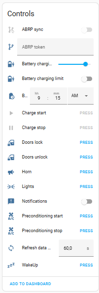
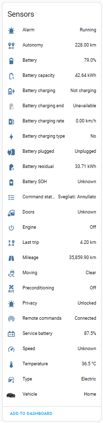
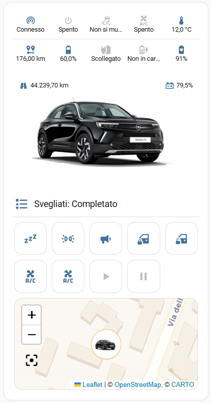
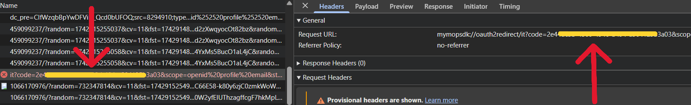
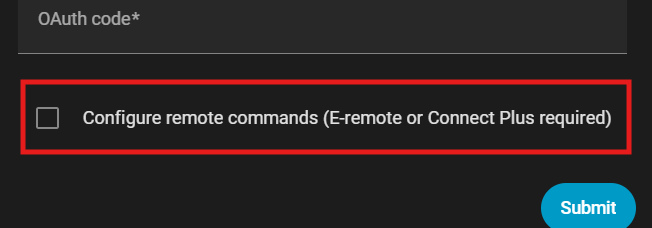
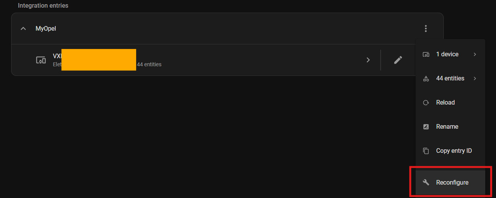

# HomeAssistant - Stellantis Vehicles (Pfush fork)

> **This is a modified fork** of [andreadegiovine/homeassistant-stellantis-vehicles](https://github.com/andreadegiovine/homeassistant-stellantis-vehicles).
> It is **not** the original extension. Updates, fixes and issues are handled **only in this repository**:
> [https://github.com/Frxdi/HA-StellantisPfush](https://github.com/Frxdi/HA-StellantisPfush).

**What is different from the original**
- The automatic login ("remote service") uses **[stelloauth](https://github.com/tamcore/stelloauth)** (default: `https://stelloauth.tollet.me`) instead of the shared Render.com worker.
- The stelloauth response is parsed tolerantly (plain JSON, event stream and NDJSON), so a changed API answer no longer breaks the login.
- In manual mode you can paste the **whole redirect URL**; only the `code` value is used.
- Update location (`manifest.json`, `hacs.json`, documentation and issue links) points to this repository.

- [Requirements](#requirements)
- [Features](#features)
- [Installation](#installation)
- [Screenshot](#screenshot)
- [OAuth2 Code](#oauth2-code)
- [Commands](#commands)
- [Battery capacity / residual sensors](#battery-capacity--residual-sensors)
- [Card: Stellantis Vehicles](#card-stellantis-vehicles)
- [Global preferences](#global-preferences)
- [Errors](#errors)
  - [OTP error - NOK:MAXNBTOOLS](#otp-error---nokmaxnbtools)
  - [OTP error - NOK:NOK_BLOCKED](#otp-error---noknok_blocked)
  - [Get oauth code error](#get-oauth-code-error)
  - [Command status 901 and 300 - Wakeup timeout](#command-status-901-and-300---wakeup-timeout)
- [ABRP - A Better Routeplanner](#abrp---a-better-routeplanner)
- [Credits](#credits)

> Currently only <ins>PSA vehicles</ins> are compatible.

| Peugeot                              | Citroën                              | DS                         | Opel                           | Vauxhall                               |
|--------------------------------------|--------------------------------------|----------------------------|--------------------------------|----------------------------------------|
|  |  |  |  |  |

## Requirements
Get status:
- **Vehicle native mobile app** installed and active;
- **Use a pc for autentication**;

Send remote commands:
- Get status requirements;
- **Remote service** actived (E-remote or Connect Plus);

> Currently Stellantis not provide B2C api credentials, this integration use the mobile apps api credentials and login flow.

## Features
|                            | Electric / Hybrid | Thermic | E-remote control | Remote control  | Connect Plus |
|----------------------------|:-----------------:|:-------:|:----------------:|:---------------:|:------------:|
| Get status                 |        ✔️         |   ✔️    |        ✔️        |                 |      ✔️      |
| Wake up                    |        ✔️         |   ✔️    |        ✔️        |                 |      ✔️      |
| ABRP sync                  |        ✔️         |   ✔️    |        ✔️        |                 |      ✔️      |
| Preconditioning start/stop |        ✔️         |   ✔️    |        ✔️        |                 |      ✔️      |
| Doors open/close           |        ✔️         |   ✔️    |                  |       ✔️        |      ✔️      |
| Flash lights               |        ✔️         |   ✔️    |                  |       ✔️        |      ✔️      |
| Honk the horn              |        ✔️         |   ✔️    |                  |       ✔️        |      ✔️      |
| Charging start/stop        |        ✔️         |         |        ✔️        |                 |      ✔️      |
| Charging limit             |        ✔️         |         |        ✔️        |                 |      ✔️      |

## Installation
<details open><summary><b>Home Assistant 2026.11 or newer (Marketplace)</b></summary>

HACS is built into Home Assistant as the **Marketplace** (Settings → Marketplace). This fork is not in the default catalog, so add it as a custom repository:

1. Open **Settings → Marketplace**;
2. Open the menu and choose **Custom repositories**;
3. Add `https://github.com/Frxdi/HA-StellantisPfush` with type **Integration**;
4. Install **PfushStellantis Vehicles** and restart Home Assistant;
5. Add the integration from **Settings → Devices & services**.

</details>
<details><summary><b>Older Home Assistant (HACS)</b></summary>

1. In [HACS](https://hacs.xyz/) open the menu → **Custom repositories**;
2. Add `https://github.com/Frxdi/HA-StellantisPfush` with category **Integration**;
3. Install **PfushStellantis Vehicles** and restart Home Assistant;
4. Add the integration from **Settings → Devices & services**.

</details>
<details><summary><b>Manually</b></summary>

1. Download this repository;
2. Copy **custom_components/stellantis_vehicles** to **config/custom_components/stellantis_vehicles**;
3. Restart Home Assistant;
4. Add the integration from **Settings → Devices & services**.

</details>

> Do not install the original repository next to this fork: both use the domain `stellantis_vehicles`.

## Screenshot
### Entities


### Vehicle Card


Documented on [Card: Stellantis Vehicles](#card-stellantis-vehicles) section.

## OAuth2 Code
### Remote service
The default **remote service** is [stelloauth](https://github.com/tamcore/stelloauth), hosted at `https://stelloauth.tollet.me`. It simulates a browser login on the official website to get your OAuth code.

<ins>**Your credentials are neither stored nor shared**</ins>

You can also self-host stelloauth and enter its URL in the **Login service URL** field of the remote-login step. The URL must contain `stelloauth`, because the integration then talks to `<url>/oauth` with `brand`, `country`, `email` and `password`.

### Manual
<details><summary><b>Using browser console</b></summary>

As described in the config flow, get the code from the mobile app redirect (Chrome example). You may paste the complete redirect URL, only the code is used:



</details>
<details><summary><b>Using the stelloauth web page</b></summary>

Open <https://stelloauth.tollet.me>, pick brand and country, log in and paste the returned code into the manual step.

</details>
<details><summary><b>Using python tool</b></summary>

[stellantis-oauth-helper](https://github.com/benbox69/stellantis-oauth-helper) by [@benbox69](https://github.com/benbox69).

</details>

## Commands
To use remote commands, the "E-remote" or "Connect Plus" service must be activated and configured in the vehicle.

How to complete the OTP step and activate remote commands:
<details><summary><b>New configuration</b></summary>



</details>
<details><summary><b>Existing configuration</b></summary>



</details>

### WakeUp
For some vehicles no updates are received a few minutes after the engine is turned off. Use automations like these to schedule the vehicle wake up:

```yaml
- id: "standby_wakeup"
  alias: Vehicle standby WakeUp (every 1 hour)
  description: ""
  mode: single
  triggers:
    - trigger: time_pattern
      hours: /1
  conditions:
    - condition: state
      entity_id: binary_sensor.#####VIN#####_battery_charging
      state: "off"
  actions:
    - action: button.press
      metadata: {}
      data: {}
      target:
        entity_id: button.#####VIN#####_wakeup
```

```yaml
- id: "charging_wakeup"
  alias: Vehicle charging WakeUp (every 5 minutes)
  description: ""
  mode: single
  triggers:
    - trigger: time_pattern
      minutes: /5
  conditions:
    - condition: state
      entity_id: binary_sensor.#####VIN#####_battery_charging
      state: "on"
  actions:
    - action: button.press
      metadata: {}
      data: {}
      target:
        entity_id: button.#####VIN#####_wakeup
```
\* the entity names above are in english, please use your language entity names.

<ins>**Some users report that performing too many wakeups drains the service battery, making some features unavailable (such as keyless entry)**</ins>.

### Air conditioning Start/Stop
As described in the Stellantis apps, the command is enabled when:
1. The vehicle engine is off;
2. The vehicle doors are locked;
3. The battery level is at least ~~50% (20% for hybrids)~~ 20% or in charging ([#226](https://github.com/Frxdi/HA-StellantisPfush/issues/226));

## Battery capacity / residual sensors
Thanks to the community ([#272](https://github.com/Frxdi/HA-StellantisPfush/issues/272)), it seems that for some vehicles **Stellantis provides incorrect values**. The **switch.battery_values_correction** entity (in your language) applies a correction if active.

\*currently only to the battery_residual sensor

## Card: Stellantis Vehicles
A new custom card is available to manage the vehicle, the card is configurable from the visual editor or via yaml:
```
type: custom:stellantis-vehicle-card
entity: device_tracker.#####VIN#####_vehicle
hide_features: false
features_icons_size: 20
features:
  - binary_sensor.#####VIN#####_remote_commands
  - sensor.#####VIN#####_battery
hide_content: false
content_icons_size: 14
content:
  - sensor.#####VIN#####_temperature
  - sensor.#####VIN#####_last_trip
hide_actions: false
actions:
  - button.#####VIN#####_wakeup
  - button.#####VIN#####_charge_start
hide_charging_limit: false
hide_charging_start: false
hide_map: false
hide_last_trip: false
hide_last_charge: false
```
\* the entity names above are in english, please use your language entity names.

Some users report bugs during first use or after page refresh ([#440](https://github.com/Frxdi/HA-StellantisPfush/issues/440), [#441](https://github.com/Frxdi/HA-StellantisPfush/issues/441)), it seems like a browser or mobile app cache issue.

To reset mobile app cache try: **Settings > app settings > Problem solving > Reset frontend cache**

## Global preferences
These initial choices can be changed in the **Reconfigure** flow under **Global preferences**:
- Enable persistent notifications
- Anonymize personal data on logs

Thanks to the community ([#414](https://github.com/Frxdi/HA-StellantisPfush/issues/414)), it seems that for some hardware, the "Anonymize personal data on logs" feature makes the environment unstable. It is recommended to disable this feature and enable it only when you need to share logs.

## Errors
<ins>Before any issue request, please check the integration log and look for solution below</ins>.

### OTP error - NOK:MAXNBTOOLS
It seems that this error is due to reaching the limit of associated devices / SMS received. Restore your Stellantis account and try again:
[Follow this procedure from Peugeot community](https://peugeot.my-customerportal.com/peugeot/s/article/AP-I-have-problems-with-the-pin-safety-code-or-I-want-to-change-it-What-can-I-do?language=en_GB).

<ins>**This operation removes the devices connected to your vehicle, no vehicle data will be lost**</ins>.

### OTP error - NOK:NOK_BLOCKED
It seems that this error is due to reaching the limit of wrong PIN used. Re-authenticate the integration.

### Get oauth code error
As described in the "OAuth2 Code > [Remote service](#remote-service)" section, this free service has usage limitations.  
If you've hit these limits, please wait and try again.  
If the problem persists or is unrelated to usage limits, please use "OAuth2 Code > [Manual](#manual)" mode.

### Command status 901 and 300 - Wakeup timeout
**901 (Wakeup Vehicle)** is the wakeup command being forwarded from the Stellantis backend to your vehicle, it doesn't say anything about the vehicle's state by itself. If it's followed by **300 (Timeout)** instead of **0 (Complete)**, the vehicle didn't respond, which means it's in a deep sleep.

Stellantis disables connectivity to protect the 12V battery, the vehicle apps explain it like this:

> Your vehicle has not been used for more than 15 consecutive minutes in the last 7 days. To preserve your 12V battery, connectivity is disabled.

This is tracked per vehicle, not per integration: any trip shorter than 15 minutes doesn't count, no matter how close it gets. If all your trips in the last 7 days were under 15 minutes, connectivity gets disabled and every wakeup times out until a trip passes the threshold again.

To avoid repeated timeouts, take at least one trip longer than 15 minutes every 7 days.

## ABRP - A Better Routeplanner
Get a token from [ABRP](https://abetterrouteplanner.com/):
1. Login to your account;
2. Navigate to vehicle settings;
3. Navigate to real time data;
4. Navigate to edit connections;
5. Generate a token using "Generic" method;

Use the generated token in **abrp_token sensor** and enable **abrp_sync switch** to send updates.

## Credits
- Original integration: [andreadegiovine](https://github.com/andreadegiovine/homeassistant-stellantis-vehicles) and its contributors (translations included).
- OTP / API research: [PSA Car Controller](https://github.com/flobz/psa_car_controller) by [Florian BEZANNIER](https://github.com/flobz).
- Login service: [stelloauth](https://github.com/tamcore/stelloauth) by tamcore, based on [stellantis-oauth-helper](https://github.com/benbox69/stellantis-oauth-helper).

Licensed under the terms in [LICENSE](./LICENSE). Use at your own risk, this is an unofficial integration.
